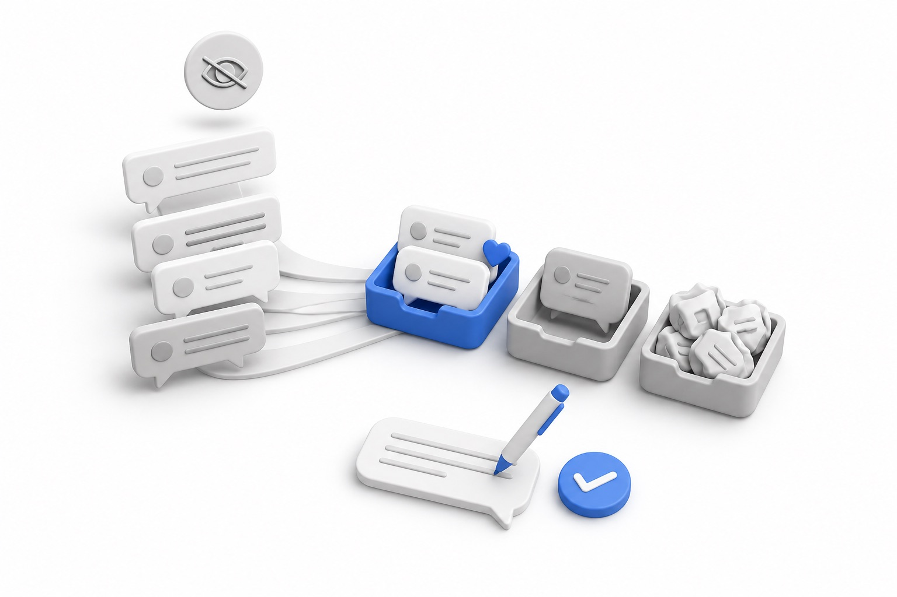
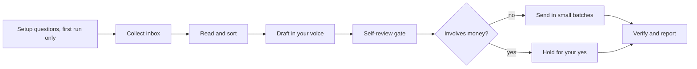

# linkedin-inbox-triage

<p align="center">
  
</p>

<p align="center">
  <b>Find the real people in your LinkedIn inbox and answer them</b>
</p>

<p align="center">
  
  
  
  <a href="https://maritime.sh"></a>
</p>

<p align="center"><sub>WORKS WITH</sub><br>
  
  
  
  
</p>

A Claude Code skill that goes through your LinkedIn inbox for you. It reads every conversation in Focused and Other, tells real people worth answering apart from sales pitches, job asks, bots and AI-written templates, drafts replies in your own voice, checks each one hard, sends the safe ones, and reports every message it sent in full.

It reads threads without opening them, so senders do not see a "Seen" receipt for messages it skips.

## What you get

- Replies to the people worth answering, in your voice, built from your own past messages.
- A report after the run: every message sent (full text, who, why it passed the check), what is left for you with a ready draft, and what was skipped and why.
- A check afterwards that each reply went out exactly once.
- Judgment calls left to you: live conversations, investors, recruiters, anything about money.

| It does | It never does |
| --- | --- |
| Replies to people already in your inbox | Send connection requests or cold messages |
| Sends replies that pass its self-review | Send anything that names a price, discount or invoice without your yes |
| Leaves live threads, investors and recruiters to you | Click through a warning, CAPTCHA or login screen |
| Stops at 25 replies per run, with pauses | Send the same text to two people |

## Requirements

- [Claude Code](https://claude.com/claude-code)
- The [Claude in Chrome](https://claude.com/chrome) extension, connected to Claude Code
- Google Chrome, signed in to LinkedIn
- Python 3 (for the send helper)

## Install

```bash
git clone https://github.com/mariagorskikh/linkedin-inbox-triage ~/.claude/skills/linkedin-inbox-triage
```

Restart Claude Code so it picks up the skill.

## Setup

On the first run the skill asks a few questions in one batch: a handful of replies you have sent (or it reads your recent ones), who is high priority for you, what it should never send without you, what you offer and which links you share, and whether you want autonomous or review mode. It writes `voice.md` and `config.yaml` and carries on. Later runs ask nothing.

You can also fill them in yourself:

```bash
cd ~/.claude/skills/linkedin-inbox-triage
cp voice.example.md voice.md
cp config.example.yaml config.yaml
```

Both files are git-ignored and stay on your machine.

## Example prompts

- "Check my LinkedIn"
- "Anyone worth answering on LinkedIn this week?"
- "Go through my LinkedIn DMs and draft replies, don't send anything"
- "Triage my LinkedIn inbox, including the Other folder"
- "Send the investor one you held"

## How it works



1. **Setup, once.** The first run asks its questions in one batch and writes `voice.md` and `config.yaml`. After that it runs end to end without asking.
2. **Collect.** In your Chrome, it opens LinkedIn's messaging page on a screen that does not open any thread, then reads your conversation list through the same web API calls the page itself uses. Reading this way does not mark anything as read.
3. **Read and sort.** It reads full threads for anything promising or unclear, and sorts each conversation into buckets: deal with first, mid-conversation, reply, quick one-liner, your call, borderline, no reply needed, skip. See `references/classification.md`.
4. **Draft and self-review.** Every draft is checked against the thread and your `voice.md`: right bucket, answers what they asked, your length and tone, no invented facts, only your own links, no repeats. Anything that fails is fixed or held.
5. **Send.** Replies that passed go out in batches of three with a pause after each person. Before each send it re-checks the thread, so it will not reply if you already answered from your phone, and it stops everything if LinkedIn shows any warning.
6. **Verify and report.** It re-reads each thread to confirm exactly one new message went out, then reports everything it sent in full, plus the held drafts waiting for you.

**What waits for you.** Anything that involves money (prices, discounts, paid offers, invoices) waits for your yes in chat; the send helper refuses those without it. Live conversations (you wrote in the last 24 hours), investors, recruiters, anything on your "never send without me" list, and security follow-ups beyond a thank-you are drafted and held for you, never sent on their own.

**Review mode.** Set `autonomy.mode: review` in `config.yaml` and it stops before sending, shows every draft with context and the person's message, and sends only what you approve word for word.

## Safety and caveats

- **Read the LinkedIn User Agreement.** It restricts bots and automated access to LinkedIn. Using this skill may violate it, and your account could be limited or restricted. You are responsible for how you use it. Autonomous mode sends replies without a per-message okay from you, so running it that way is your choice to accept that risk; `mode: review` keeps a human approval on every message.
- **Self-review before every send.** In autonomous mode the agent marks a reply as approved only after it passes the self-review gate. The send helper is a dry run by default and refuses any reply not marked approved, and any reply that mentions money without your yes.
- **Replies only.** It never sends connection requests, never messages people who are not already in your inbox, and refuses to send the same text twice in a run.
- **Low volume, slow pace.** At most 25 replies per run, small batches, and a pause between each person.
- **Stops on friction.** Any warning, CAPTCHA, limit notice or login challenge stops all sending. It never clicks through them.
- **It will break sometimes.** LinkedIn changes its web app often. The selectors and API details in `scripts/` may stop working. `references/mechanics.md` explains how each piece works so you or Claude can fix it.
- **Your data stays local.** Conversations are read in your browser tab and held in that tab's session storage until the tab closes.

## Files

```
SKILL.md                     instructions Claude follows
config.example.yaml          autonomy mode and limits (copy to config.yaml)
voice.example.md             template for your voice (copy to voice.md)
references/classification.md how messages are sorted
references/voice-guide.md    how your voice is built and used
references/mechanics.md      how the scripts talk to LinkedIn, and how to fix them
scripts/collect.js           read the conversation list
scripts/dump.js              print a slice of it for Claude to read
scripts/threads.js           read full threads
scripts/send_batch.py        build the send steps for approved replies (dry run by default)
scripts/verify.js            check that each reply went out once
assets/hero.jpg              README image
```

## Built by Maritime

<p align="center">
  <a href="https://maritime.sh">
    <picture>
      <source media="(prefers-color-scheme: dark)" srcset="assets/maritime-dark.png">
      
    </picture>
  </a>
</p>

This skill is open-sourced by [Maritime](https://maritime.sh) (YC F26), the cloud platform that gives every AI agent its own computer: sandboxes, agent boxes that keep their disk, and Linux desktops, Windows desktops and Android phones your agent can see and click. We run this skill ourselves.

## More open-source skills from Maritime

- [talking-head-reel](https://github.com/mariagorskikh/talking-head-reel): turn a messy phone recording into an edited vertical reel
- [outreach-conductor](https://github.com/mariagorskikh/outreach-conductor): a weekly outbound cycle, researched and written in your voice
- [product-changelog](https://github.com/mariagorskikh/product-changelog): changelog email, social posts and video from what you shipped
- [slack-connect-onboarding](https://github.com/mariagorskikh/slack-connect-onboarding): shared Slack channels with customers, with a real welcome
- [ad-ops](https://github.com/mariagorskikh/ad-ops): run Google, Meta, X and Reddit ad accounts with a change ledger

## License

MIT. See `LICENSE`.
